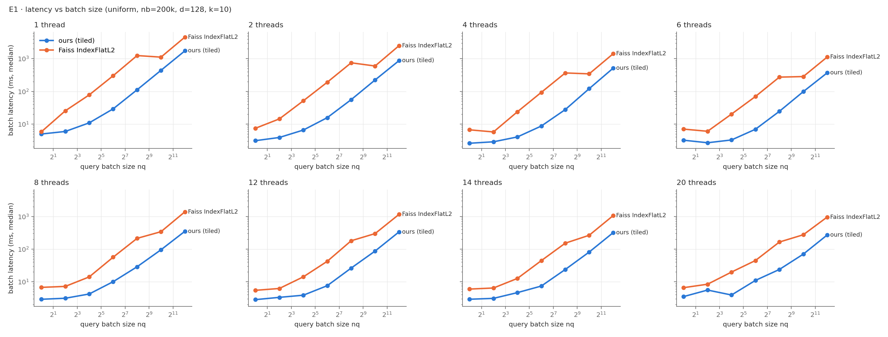
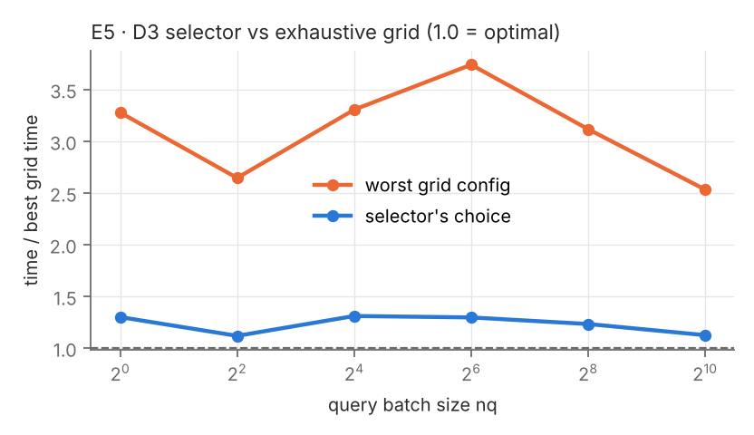
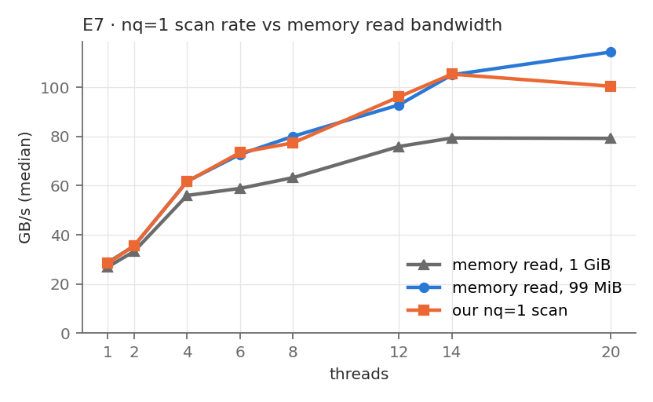

# Project 17 — Memory-efficient exact nearest-neighbour search (CS F422)

Exact Euclidean top-k over dense float32 vectors on a multicore CPU with OpenMP,
built on the exact-search ideas of Johnson, Douze & Jégou, *Billion-scale
Similarity Search with GPUs* (arXiv 2017), and compared against Faiss's CPU
exact flat L2 search (`IndexFlatL2`).

```
include/knn.h            public API + output contract (tie policy)
src/reference.cpp        D1  sequential brute-force reference + exact-neighbour checker
src/tiled.cpp            D2  OpenMP tiled distances + per-query top-k heaps
                         D3  tile / parallelism selector (select_params)
src/data.cpp             3 input families, .fbin / .fvecs I/O
tests/test_knn.cpp       hand-checked cases, checker self-test, 120 randomized differential tests
bench/knn_bench.cpp      benchmark driver (gen / run / check), CSV output
bench/bandwidth.cpp      STREAM-style memory read benchmark (E7)
bench/faiss_bench.py     Faiss IndexFlatL2 baseline with identical CSV columns
scripts/run_experiments.sh   reproduces E1–E7
scripts/e8_oversplit.py      E8, run by hand (steps at the top of the script)
scripts/analyze.py       results/*.csv -> results/summary.md + figures
results/                 laptop results: raw CSVs, summary.md, figures, e8_oversplit.md
results_2core_vm/        older results from the 2-vCPU cloud VM (AVX-512)
```

## Build & run

```bash
# deps: g++ >= 9 (OpenMP), cmake >= 3.16; for the baseline: pip install numpy faiss-cpu matplotlib
cmake -S . -B build -DCMAKE_BUILD_TYPE=Release && cmake --build build -j
./build/knn_test                         # all correctness tests
scripts/run_experiments.sh               # E1..E7 (~8 min on the laptop); or e.g. "scripts/run_experiments.sh E1"
python3 scripts/analyze.py               # tables + plots
# sanitizer build: cmake -S . -B build-asan -DKNN_SANITIZE=ON && cmake --build build-asan && ./build-asan/knn_test
```

All results in `results/` (E1–E8) are from one machine: Intel i7-13650HX laptop (6 P-cores
+ 8 E-cores, 20 threads), WSL2 Ubuntu 22.04, 7 GiB RAM visible, g++ 11.4, cmake 3.22,
Python 3.10, numpy 2.2.6, faiss-cpu 1.16.0 (pip wheel, OpenBLAS 0.3.15). Both programs are
pinned with `OMP_PROC_BIND=close OMP_PLACES=threads`, except where stated. Kernel: AVX2
6 × 16, with 1 × 16 and 2 × 16 for nq = 1 and 2. The AVX-512 kernel cannot run on this
machine; it was measured only on the [second machine](#second-machine-avx-512).
E1–E4 use the current code; E5–E8 were run before tile buffers were kept between searches
(see [Memory](#memory)).

## Input/output contract

* Input: database `Y` (nb × d), queries `X` (nq × d), float32 row-major; `k ≥ 1`.
* Output: `D[nq×k]` squared L2 distances, `I[nq×k]` int64 ids.
* **Tie policy:** rows are sorted by *(distance ascending, id ascending)*; when two
  vectors are equally far, the **smaller id wins**, both for membership in the
  top-k and for order. If nb < k the row is padded with `(+inf, -1)`.

## What each deliverable does

### D1 — reference + checker (`src/reference.cpp`)
`reference_search` computes every distance in **double precision** directly as
Σ(x−y)² (no norm expansion → no cancellation error), then `partial_sort`s with
the tie policy. It is slow on purpose (22–25 ms/query at nb=200k, d=128 on the laptop, E6) — it's
ground truth.

`check_results` decides if any result is exact. Floating-point means the fast
code can legitimately disagree with the reference on near-ties, so there are two
levels:
* **tolerant** (pass/fail): every id valid and unique; each returned id's true
  distance ≤ k-th true distance + tol; each reported distance = true distance ± tol;
  row sorted. `tol = 16·ε₃₂·√d·(‖x‖² + max‖y‖²)`.
* **strict**: ids identical to the reference (tie policy applied identically).
  For the integer-valued `ties` family all float maths is exact, so the tests
  *require* strict equality there.

The checker is itself tested: it must reject duplicate ids, out-of-range ids, a
far point swapped in, a wrong distance, and an unsorted row.

### D2 — OpenMP tiled distances + per-query top-k (`src/tiled.cpp`)
1. **Norm expansion (paper §5.1):** ‖x−y‖² = ‖x‖² + ‖y‖² − 2⟨x,y⟩. ‖y‖² is computed
   once at pack time; ‖x‖² is constant per query so selection runs on
   `‖y‖² − 2⟨x,y⟩` and ‖x‖² is added at the end (exactly the paper's trick).
2. **Packed database (preprocessing, timed separately):** rows grouped into
   panels of 16, stored dimension-major inside a panel, so one 64-byte load
   gives dimension t of 16 database rows. Padding rows get ‖y‖² = +∞ so they never win.
3. **Register-blocked micro-kernel** (the inner loop of a GEMM), chosen at compile
   time; `MR` = queries per call:
   * **AVX-512** (`__AVX512F__`): 4 queries × 32 rows → 8 accumulators, 2 loads and
     8 broadcast-FMAs per step, written with GCC/Clang vector extensions.
   * **AVX2 + FMA:** 6 queries × 16 rows in intrinsics → 12 accumulators + 2 loads
     + 1 broadcast = 15 of the 16 registers (no spills in the inner loop, checked
     with `objdump`). A 4 × 16 tile was also tried: slower at nq = 64 and 4096,
     faster at nq = 1. For nq = 1 and 2 the selector uses 1 × 16 and 2 × 16
     kernels instead of padding to 6 rows; from nq = 3 on, padding is faster.
   * Otherwise the 4 × 32 vector-extension code is the portable fallback. It is
     correct but slow on AVX2: each 16-float vector becomes two registers, so the
     8 accumulators alone fill the register file, and g++ 11 spills them to the
     stack on every step.
4. **Two-level tiling:** a database block of `tb` rows (sized to ½ L2) is kept hot
   while every `MR`-query group of a `tq`-query tile streams over it, so each
   database element fetched from memory is reused `tq` times.
5. **Fused selection from registers:** the paper fuses k-selection with the
   kernel consuming the GEMM output so the nq×nb matrix is never written. We go
   further: distances are consumed straight from the micro-kernel registers into
   per-query **bounded max-heaps** (root = current worst). A 16-lane vector
   compare against the heap threshold skips whole panels; only survivors touch
   the heap. **No distance tile is ever stored.**
6. **Exact tie handling in the hot path:** within a task ids are scanned in
   increasing order, so a candidate equal to the threshold must lose → the
   strict `<` filter is exact. After adding ‖x‖² the row is re-sorted by the policy
   (adding ‖x‖² can create new float ties).
7. **Parallelism:** tasks = (query tile) × (database chunk), `schedule(dynamic)`.
   With S = 1 chunk the output arrays *are* the heaps (no extra heap memory). With
   S > 1 each chunk keeps its own heaps and a per-query merge picks the final k.

### D3 — tile / parallelism selector (`select_params`)
* `tb` = rows such that `tb·d·4 B ≈ L2/2` (read from `sysconf`).
* `tq` = 64 rounded up to a multiple of `MR` (64 on AVX-512, 66 on AVX2; shrunk when the tile + heaps exceed L2/4, and when nq is small).
* `S` (database splits): smallest S giving ≥ T tasks with ≤ 25% load imbalance,
  limited by blocks per chunk and a partial-heap memory budget (64 MiB).
  → **small batches become database-parallel** (each thread scans nb/S rows —
  the only way to use all cores for 1 query), **large batches become
  query-parallel** (no partial heaps to merge).

## Results (from `results/summary.md`)

Times are medians of 5 repetitions (E7: 5 rounds; E8: see its file). Unless stated:
uniform data, nb = 200k, d = 128, k = 10. All 158 runs in E1–E4 (both libraries)
pass the checker (up to 32 sampled queries per run).

### E1: batch size × threads




Faiss time / our time at the same thread count (above 1 = we are faster):

| nq | T=1 | 2 | 4 | 6 | 8 | 12 | 14 | 20 |
|---|---|---|---|---|---|---|---|---|
| 1 | 1.17 | 2.40 | 2.58 | 2.19 | 2.31 | 1.93 | 2.05 | 1.87 |
| 4 | 4.29 | 3.71 | 2.00 | 2.24 | 2.31 | 1.87 | 2.08 | 1.51 |
| 16 | 7.18 | 7.86 | 5.90 | 6.19 | 3.33 | 3.65 | 2.72 | 5.04 |
| 64 | 10.34 | 12.15 | 10.75 | 10.07 | 5.63 | 5.58 | 6.00 | 4.06 |
| 256 | 11.19 | 13.44 | 13.25 | 11.18 | 7.42 | 6.87 | 6.39 | 6.91 |
| 1024 | 2.53 | 2.67 | 2.84 | 2.89 | 3.58 | 3.43 | 3.27 | 3.92 |
| 4096 | 2.64 | 2.87 | 2.76 | 3.05 | 3.95 | 3.44 | 3.33 | 3.54 |

* **nq = 4 to 256**, where Faiss 1.16 uses its per-pair sequential path: 1.5–13.4× faster.
* **nq ≥ 1024** (Faiss BLAS path): 2.5–4.0× faster.
* **nq = 1, 1 thread:** 4.94 vs 5.78 ms here, but treat it as a tie: in a separate 9-round
  comparison the two were within 6% with overlapping ranges.
* **Self-speedup** (over each library's own 1-thread time), ours / Faiss:

| nq | T=2 | 4 | 6 | 8 | 12 | 14 | 20 |
|---|---|---|---|---|---|---|---|
| 1 | 1.60 / 0.78 | 1.92 / 0.87 | 1.55 / 0.83 | 1.70 / 0.86 | 1.75 / 1.06 | 1.70 / 0.97 | 1.41 / 0.88 |
| 64 | 1.86 / 1.58 | 3.35 / 3.22 | 4.21 / 4.32 | 2.91 / 5.34 | 3.85 / 7.14 | 3.95 / 6.79 | 2.65 / 6.75 |
| 4096 | 2.00 / 1.84 | 3.40 / 3.25 | 4.72 / 4.08 | 4.97 / 3.31 | 5.20 / 3.98 | 5.49 / 4.36 | 6.45 / 4.80 |

  At nq = 64 Faiss scales better from 6 threads on, from a 1-thread time that is 10.3× longer
  (301 vs 29.1 ms). The 20-thread column is the noisiest. WSL hides P- and E-cores, so T = 12 is not "P-cores only".

### E2–E4: dimension, k, input family (14 threads)

Ours / Faiss in ms (Faiss time / our time). 14 threads, because earlier runs with all 20
were too noisy. Only d = 32, nq = 1 (under 0.3 ms for both) still has a standard deviation above 15% of
its median: read it as "faster", not as a precise ratio.

E2, nb = 100k, k = 10:

| d | nq = 1 | nq = 64 | nq = 1024 |
|---|---|---|---|
| d = 32 | 0.09 / 0.27 (3.1×) | 1.05 / 3.59 (3.4×) | 12.55 / 58.25 (4.6×) |
| d = 128 | 1.10 / 2.96 (2.7×) | 3.45 / 18.25 (5.3×) | 45.93 / 139 (3.0×) |
| d = 512 | 6.01 / 14.39 (2.4×) | 13.02 / 89.78 (6.9×) | 168 / 430 (2.6×) |

E3:

| k | nq = 16 | nq = 1024 |
|---|---|---|
| k = 1 | 3.81 / 13.26 (3.5×) | 81.18 / 226 (2.8×) |
| k = 10 | 4.03 / 12.82 (3.2×) | 82.22 / 272 (3.3×) |
| k = 100 | 4.26 / 15.72 (3.7×) | 96.73 / 274 (2.8×) |
| k = 1000 | 8.77 / 12.64 (1.4×) | 159 / 311 (2.0×) |

E4, k = 10:

| family | nq = 1 | nq = 64 | nq = 1024 |
|---|---|---|---|
| clustered | 2.95 / 6.31 (2.1×) | 6.98 / 42.58 (6.1×) | 82.83 / 270 (3.3×) |
| ties | 3.06 / 7.01 (2.3×) | 7.34 / 40.81 (5.6×) | 84.04 / 268 (3.2×) |

* **Unfavourable case, large k:** the lead falls from 3.3× (k = 10) to 2.0× (k = 1000) at
  nq = 1024, and from 3.2× to 1.4× at nq = 16, as heap updates cost more.

### E5: selector against a grid (20 threads)



* Grid: S ∈ {1, 2, 4, 8, 16, 20} × tq ∈ {4, 16, 64} (rounded up to 6, 18, 66) × tb ∈
  {256, 2048, 16384} = 54 configs per nq.
* The selector is within 0.99–1.30× of the best grid config; the worst config is
  2.4–6.9× slower than the best.
* It splits the database (S > 1) for every nq from 1 to 1024, and the best grid config does too.
  For nq ≤ 16 it picks S = 20 while S = 8 was fastest; a smaller S for tiny batches
  is the main remaining gap.

### E6: sequential double-precision reference

24.9 ms for 1 query, 21.9 ms per query for 16.

### E7: is nq = 1 limited by memory bandwidth?



Yes. From 1 to 14 threads our nq = 1 scan (packed database bytes / time) runs at 90–103% of
a plain memory read of a same-sized array:

| T | read 99 MiB (GB/s) | our scan (GB/s) | ratio |
|---|---|---|---|
| 1 | 21.6 | 22.2 | 103% |
| 2 | 25.0 | 25.8 | 103% |
| 4 | 33.4 | 33.8 | 101% |
| 6 | 40.5 | 39.4 | 97% |
| 8 | 39.1 | 35.0 | 90% |
| 12 | 36.0 | 33.6 | 93% |
| 14 | 35.2 | 33.4 | 95% |
| 20 | 19.0 | 13.2 | 70% (unstable: scan 10–35 GB/s between rounds) |

One thread scans a database that fits in L2 at 64.5 GB/s, 2.9× its speed from RAM, so the
kernel is not the limit. One thread already uses 21.6 of the at most 40.5 GB/s, which allows
at most about 1.9× from more threads; E1's best nq = 1 self-speedup is 1.92×.

### E8: over-decomposition (tried, not kept)

Giving each thread about 4 database chunks made nq = 64 at 8 threads 19–24% faster, but was
up to 46% slower at k = 1000, and a restricted version was up to 23% slower at 6 threads,
so the selector was left unchanged. Details: [results/e8_oversplit.md](results/e8_oversplit.md).

### Memory

Extra memory of the search over the 79 E1–E4 cases:

| | Ours, calculated | Ours, measured | Faiss, measured |
|---|---|---|---|
| Faiss BLAS path (24 cases) | 33 KiB – 4.0 MiB | 0.0 – 3.8 MiB | 5.6 – 41.2 MiB |
| Faiss sequential path (55 cases) | 3 KiB – 1.9 MiB | 0.0 – 2.3 MiB | 0.0 – 6.7 MiB |

* *Calculated* (`tiled_working_bytes`) is the tile copies plus partial heaps. *Measured* is the
  growth of peak RSS over 6 searches, the same way for both. It includes thread stacks and
  allocator overhead, but reads low (even 0, or below the calculated size) when
  earlier setup already set a higher peak.
* **BLAS path:** we measured less than Faiss in all 24 cases. E1 at nq = 4096:
  0.2–1.1 MiB against 19.4–20.3 MiB.
* **Sequential path:** mixed. We measured less in 31 cases, the same in 11 and more in 13,
  so "memory efficient" is not a claim for that path.
* **Tile buffers are kept.** Each thread keeps its query-tile buffer between searches and only
  grows it, instead of allocating and freeing it in every search. Peak growth at d = 512,
  nb = 100k, nq = 4096, 20 threads (peak counter reset before the first search, 3 runs; calculated size 3.5 MiB):

| Searches | Before | After |
|---|---|---|
| 1 | 3.9–4.1 MiB | 3.9 MiB |
| 11 | 26.2–26.4 MiB | 4.5–4.6 MiB |
| 101 | 26.2–26.4 MiB | 4.5–4.6 MiB |

### Second machine (AVX-512)

A shared 2-vCPU cloud VM (Xeon 2.1 GHz, AVX-512 4 × 32 kernel, Ubuntu 24.04, g++ 13.3, not
pinned, noisy), earlier code. Do not compare its times with the laptop's. E1 there: 0.96×
(nq = 1, 1 thread) to 8.8× against Faiss; 2.5–3.1× for nq ≥ 1024; calculated working memory at most 80 KiB
in E1. Full tables: [results_2core_vm/summary.md](results_2core_vm/summary.md).

**Fairness notes.** Same machine, same data files, same thread count via
`omp_set_num_threads`, same pinning, only `search` timed (Faiss `add` and
our packing are reported as preprocessing), outputs preallocated for both.
Faiss here is the pip wheel with OpenBLAS 0.3.15; an MKL build of Faiss would
likely be faster on the BLAS path, so we **don't claim general superiority** —
our claim is for the constrained regime the brief suggests: **small/medium
batches** (and, on Faiss's BLAS path, less extra memory in every case we measured). Faiss's current `main` adds a
database-parallel path for nq < threads that 1.16 doesn't use here; that would
narrow the nq=1 gap.

## Suggested team split (3 people)
* Baseline/correctness: D1, checker, tests, tie policy, data families.
* Parallel implementation: packing, micro-kernel, heaps, OpenMP tasks, merge.
* Evaluation: D3 selector + ablation, Faiss harness, experiments, plots, report.

## Ideas for the remaining weeks / report
* Run on a real dataset: SIFT1M via `read_fvecs` (`src/data.cpp`).
* Replace the heap with a small sorted buffer / two-pass threshold for k ≥ 256.
* Calibrate the selector's crossover empirically at install time.
* Profile with `perf stat` (FLOP rate vs peak, cache misses) for the bottleneck section.
