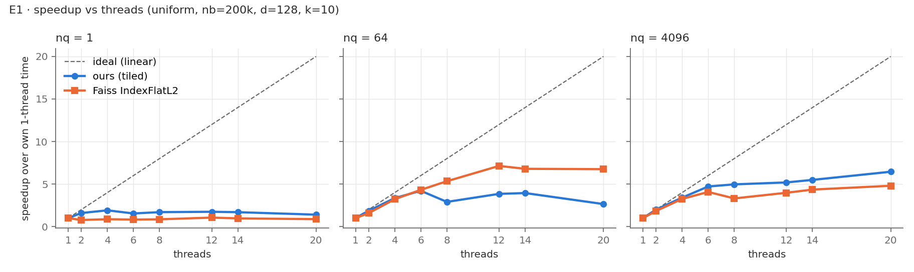
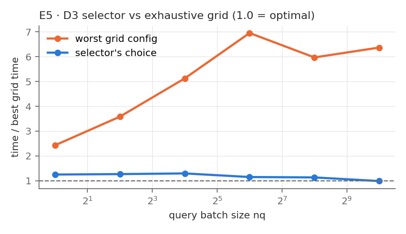
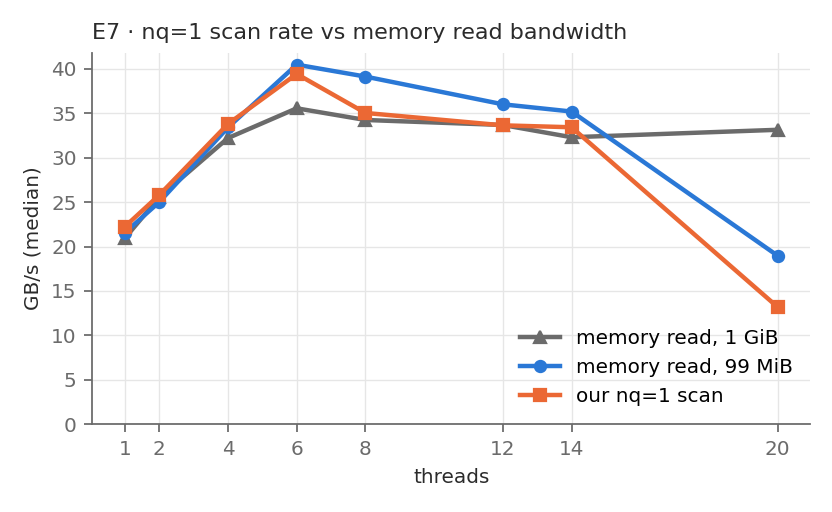

# Project 17 — Memory-efficient exact nearest-neighbour search (CS F422)

Exact Euclidean top-k over dense float32 vectors on a multicore CPU with OpenMP,
built on the exact-search ideas of Johnson, Douze & Jégou, *Billion-scale
Similarity Search with GPUs* (arXiv 2017), and compared against Faiss's CPU
exact flat L2 search (`IndexFlatL2`).

```
include/knn.h            public API + output contract (tie policy)
src/reference.cpp        D1  sequential brute-force reference + exact-neighbour checker
src/tiled.cpp            D2  OpenMP tiled distances + per-query top-k heaps
                         D3  tile / parallelism selector (select_params)
src/data.cpp             3 input families, .fbin / .fvecs I/O
tests/test_knn.cpp       hand-checked cases, checker self-test, 120 randomized differential tests
bench/knn_bench.cpp      benchmark driver (gen / run / check), CSV output
bench/bandwidth.cpp      STREAM-style memory read benchmark (E7)
bench/faiss_bench.py     Faiss IndexFlatL2 baseline with identical CSV columns
scripts/run_experiments.sh   reproduces E1–E7 and E9–E11
scripts/e8_oversplit.py      E8, run by hand (steps at the top of the script)
scripts/analyze.py       DIR/*.csv -> DIR/summary.md + figures
scripts/machine_info.sh  describes this machine (written to DIR/machine.txt)
results/i7-13650hx/      i7 laptop: E1–E11 (all results discussed below), machine.txt
results/i9-14900hx/      i9 laptop: E1–E7, machine.txt
results_2core_vm/        older results from the 2-vCPU cloud VM (AVX-512)
```

## Build & run

```bash
# deps: g++ >= 9 (OpenMP), cmake >= 3.16; for the baseline: pip install numpy faiss-cpu matplotlib
cmake -S . -B build -DCMAKE_BUILD_TYPE=Release && cmake --build build -j
./build/knn_test                         # all correctness tests
scripts/run_experiments.sh -o results/i7-13650hx          # E1..E7, E9..E11; or add e.g. E1 E5
# without -o the folder is results/<hostname>; it gets a machine.txt and a line per run
# E9 needs SIFT1M in data/sift/ (sift_base.fvecs, sift_query.fvecs from http://corpus-texmex.irisa.fr/); skipped otherwise
python3 scripts/analyze.py results/i7-13650hx             # tables + plots in that folder
# sanitizer build: cmake -S . -B build-asan -DKNN_SANITIZE=ON && cmake --build build-asan && ./build-asan/knn_test
```

Results are kept in one folder per machine, each with a `machine.txt` (CPU, cores/threads,
RAM, OS, compiler, Faiss version, and the git commit behind each experiment):

| Folder | Machine | Experiments | Discussed below |
|---|---|---|---|
| `results/i7-13650hx/` | i7-13650HX laptop (6 P + 8 E cores, 20 threads), WSL2 Ubuntu 22.04, g++ 11.4, faiss-cpu 1.16.0 | E1–E11 | all results sections |
| `results/i9-14900hx/` | i9-14900HX laptop (8 P + 16 E cores, 32 threads); OS, RAM, compiler not recorded | E1–E7 | [one section](#i9-14900hx-e1e7), not described in detail |
| `results_2core_vm/` | 2-vCPU cloud VM, AVX-512, older code | E1–E6 | [one section](#second-machine-avx-512-2-vcpu-cloud-vm) |

On the i7, both programs are pinned with `OMP_PROC_BIND=close OMP_PLACES=threads`. Kernel:
AVX2 6 × 16, with 1 × 16 and 2 × 16 for nq = 1 and 2. The AVX-512 kernel cannot run on
either laptop. On the i7, E1–E4 and E9–E11 use the tile buffers kept between searches;
E5–E8 were run before that change (see [Memory](#memory-i7-13650hx)).

## Input/output contract

* Input: database `Y` (nb × d), queries `X` (nq × d), float32 row-major; `k ≥ 1`.
* Output: `D[nq×k]` squared L2 distances, `I[nq×k]` int64 ids.
* **Tie policy:** rows are sorted by *(distance ascending, id ascending)*; when two
  vectors are equally far, the **smaller id wins**, both for membership in the
  top-k and for order. If nb < k the row is padded with `(+inf, -1)`.

## What each deliverable does

### D1 — reference + checker (`src/reference.cpp`)
`reference_search` computes every distance in **double precision** directly as
Σ(x−y)² (no norm expansion → no cancellation error), then `partial_sort`s with
the tie policy. It is slow on purpose (22–25 ms/query at nb=200k, d=128 on the i7-13650HX, E6) — it's
ground truth.

`check_results` decides if any result is exact. Floating-point means the fast
code can legitimately disagree with the reference on near-ties, so there are two
levels:
* **tolerant** (pass/fail): every id valid and unique; each returned id's true
  distance ≤ k-th true distance + tol; each reported distance = true distance ± tol;
  row sorted. `tol = 16·ε₃₂·√d·(‖x‖² + max‖y‖²)`.
* **strict**: ids identical to the reference (tie policy applied identically).
  For the integer-valued `ties` family all float maths is exact, so the tests
  *require* strict equality there.

The checker is itself tested: it must reject duplicate ids, out-of-range ids, a
far point swapped in, a wrong distance, and an unsorted row.

### D2 — OpenMP tiled distances + per-query top-k (`src/tiled.cpp`)
1. **Norm expansion (paper §5.1):** ‖x−y‖² = ‖x‖² + ‖y‖² − 2⟨x,y⟩. ‖y‖² is computed
   once at pack time; ‖x‖² is constant per query so selection runs on
   `‖y‖² − 2⟨x,y⟩` and ‖x‖² is added at the end (exactly the paper's trick).
2. **Packed database (preprocessing, timed separately):** rows grouped into
   panels of 16, stored dimension-major inside a panel, so one 64-byte load
   gives dimension t of 16 database rows. Padding rows get ‖y‖² = +∞ so they never win.
3. **Register-blocked micro-kernel** (the inner loop of a GEMM), chosen at compile
   time; `MR` = queries per call:
   * **AVX-512** (`__AVX512F__`): 4 queries × 32 rows → 8 accumulators, 2 loads and
     8 broadcast-FMAs per step, written with GCC/Clang vector extensions.
   * **AVX2 + FMA:** 6 queries × 16 rows in intrinsics → 12 accumulators + 2 loads
     + 1 broadcast = 15 of the 16 registers (no spills in the inner loop, checked
     with `objdump`). A 4 × 16 tile was also tried: slower at nq = 64 and 4096,
     faster at nq = 1. For nq = 1 and 2 the selector uses 1 × 16 and 2 × 16
     kernels instead of padding to 6 rows; from nq = 3 on, padding is faster.
   * Otherwise the 4 × 32 vector-extension code is the portable fallback. It is
     correct but slow on AVX2: each 16-float vector becomes two registers, so the
     8 accumulators alone fill the register file, and g++ 11 spills them to the
     stack on every step.
4. **Two-level tiling:** a database block of `tb` rows (sized to ½ L2) is kept hot
   while every `MR`-query group of a `tq`-query tile streams over it, so each
   database element fetched from memory is reused `tq` times.
5. **Fused selection from registers:** the paper fuses k-selection with the
   kernel consuming the GEMM output so the nq×nb matrix is never written. We go
   further: distances are consumed straight from the micro-kernel registers into
   per-query **bounded max-heaps** (root = current worst). A 16-lane vector
   compare against the heap threshold skips whole panels; only survivors touch
   the heap. **No distance tile is ever stored.**
   For large k the heap's O(log k) updates dominate, so there is a second method: append
   every candidate below the threshold to a buffer of 2k entries; when it is full, keep the
   k best with `nth_element` and set the threshold to the k-th (O(1) amortised). Ids are
   still scanned in increasing order, so the tie policy stays exact.
6. **Exact tie handling in the hot path:** within a task ids are scanned in
   increasing order, so a candidate equal to the threshold must lose → the
   strict `<` filter is exact. After adding ‖x‖² the row is re-sorted by the policy
   (adding ‖x‖² can create new float ties).
7. **Strict mode** (`SearchParams::strict`, off by default): results identical to
   `reference_search`, ids and distances. Selection keeps k + 8 + k/8 float candidates.
   With a rigorous bound eb on the float error of the norm expansion, only rows with
   float distance ≤ (k-th float distance + 3·eb) can be in the true top k. If all of them
   are among the candidates, those are recomputed with the reference's own double-precision
   distance function and ranked by (distance, id). If that cannot be shown (for example
   many exact ties at the k-th distance), the query is rescanned in double; the number of
   rescans is reported.
8. **Parallelism:** tasks = (query tile) × (database chunk), `schedule(dynamic)`.
   With S = 1 chunk the output arrays *are* the heaps (no extra heap memory). With
   S > 1 each chunk keeps its own heaps and a per-query merge picks the final k.

### D3 — tile / parallelism selector (`select_params`)
* `tb` = rows such that `tb·d·4 B ≈ L2/2` (read from `sysconf`).
* `tq` = 64 rounded up to a multiple of `MR` (64 on AVX-512, 66 on AVX2; shrunk when the tile + heaps exceed L2/4, and when nq is small).
* Selection: buffer for k ≥ 128, heap below (measured on the i7: the smallest k at which
  the buffer was no slower at nq = 16 and 1024, for that and every larger k tested).
* `S` (database splits): smallest S giving ≥ T tasks with ≤ 25% load imbalance,
  limited by blocks per chunk and a partial-heap memory budget (64 MiB).
  → **small batches become database-parallel** (each thread scans nb/S rows —
  the only way to use all cores for 1 query), **large batches become
  query-parallel** (no partial heaps to merge).

## Results

Every section below names its machine. The i7 tables are in `results/i7-13650hx/summary.md`.

Times are medians of 5 repetitions (E7: 5 rounds; E8: see its file). Unless stated:
uniform data, nb = 200k, d = 128, k = 10. All 158 runs in E1–E4 (both libraries)
pass the checker (up to 32 sampled queries per run).

### E1: batch size × threads (i7-13650HX)




Faiss time / our time at the same thread count (above 1 = we are faster):

| nq | T=1 | 2 | 4 | 6 | 8 | 12 | 14 | 20 |
|---|---|---|---|---|---|---|---|---|
| 1 | 1.17 | 2.40 | 2.58 | 2.19 | 2.31 | 1.93 | 2.05 | 1.87 |
| 4 | 4.29 | 3.71 | 2.00 | 2.24 | 2.31 | 1.87 | 2.08 | 1.51 |
| 16 | 7.18 | 7.86 | 5.90 | 6.19 | 3.33 | 3.65 | 2.72 | 5.04 |
| 64 | 10.34 | 12.15 | 10.75 | 10.07 | 5.63 | 5.58 | 6.00 | 4.06 |
| 256 | 11.19 | 13.44 | 13.25 | 11.18 | 7.42 | 6.87 | 6.39 | 6.91 |
| 1024 | 2.53 | 2.67 | 2.84 | 2.89 | 3.58 | 3.43 | 3.27 | 3.92 |
| 4096 | 2.64 | 2.87 | 2.76 | 3.05 | 3.95 | 3.44 | 3.33 | 3.54 |

* **nq = 4 to 256**, where Faiss 1.16 uses its per-pair sequential path: 1.5–13.4× faster.
* **nq ≥ 1024** (Faiss BLAS path): 2.5–4.0× faster.
* **nq = 1, 1 thread:** 4.94 vs 5.78 ms here, but treat it as a tie: in a separate 9-round
  comparison the two were within 6% with overlapping ranges.
* **Self-speedup** (over each library's own 1-thread time), ours / Faiss:

| nq | T=2 | 4 | 6 | 8 | 12 | 14 | 20 |
|---|---|---|---|---|---|---|---|
| 1 | 1.60 / 0.78 | 1.92 / 0.87 | 1.55 / 0.83 | 1.70 / 0.86 | 1.75 / 1.06 | 1.70 / 0.97 | 1.41 / 0.88 |
| 64 | 1.86 / 1.58 | 3.35 / 3.22 | 4.21 / 4.32 | 2.91 / 5.34 | 3.85 / 7.14 | 3.95 / 6.79 | 2.65 / 6.75 |
| 4096 | 2.00 / 1.84 | 3.40 / 3.25 | 4.72 / 4.08 | 4.97 / 3.31 | 5.20 / 3.98 | 5.49 / 4.36 | 6.45 / 4.80 |

  At nq = 64 Faiss scales better from 6 threads on, from a 1-thread time that is 10.3× longer
  (301 vs 29.1 ms). The 20-thread column is the noisiest. WSL hides P- and E-cores, so T = 12 is not "P-cores only".

### E2–E4: dimension, k, input family (i7-13650HX, 14 threads)

Ours / Faiss in ms (Faiss time / our time). 14 threads, because earlier runs with all 20
were too noisy. Only d = 32, nq = 1 (under 0.3 ms for both) still has a standard deviation above 15% of
its median: read it as "faster", not as a precise ratio.

E2, nb = 100k, k = 10:

| d | nq = 1 | nq = 64 | nq = 1024 |
|---|---|---|---|
| d = 32 | 0.09 / 0.27 (3.1×) | 1.05 / 3.59 (3.4×) | 12.55 / 58.25 (4.6×) |
| d = 128 | 1.10 / 2.96 (2.7×) | 3.45 / 18.25 (5.3×) | 45.93 / 139 (3.0×) |
| d = 512 | 6.01 / 14.39 (2.4×) | 13.02 / 89.78 (6.9×) | 168 / 430 (2.6×) |

E3:

| k | nq = 16 | nq = 1024 |
|---|---|---|
| k = 1 | 3.81 / 13.26 (3.5×) | 81.18 / 226 (2.8×) |
| k = 10 | 4.03 / 12.82 (3.2×) | 82.22 / 272 (3.3×) |
| k = 100 | 4.26 / 15.72 (3.7×) | 96.73 / 274 (2.8×) |
| k = 1000 | 8.77 / 12.64 (1.4×) | 159 / 311 (2.0×) |

E4, k = 10:

| family | nq = 1 | nq = 64 | nq = 1024 |
|---|---|---|---|
| clustered | 2.95 / 6.31 (2.1×) | 6.98 / 42.58 (6.1×) | 82.83 / 270 (3.3×) |
| ties | 3.06 / 7.01 (2.3×) | 7.34 / 40.81 (5.6×) | 84.04 / 268 (3.2×) |

* **Unfavourable case, large k:** the lead falls from 3.3× (k = 10) to 2.0× (k = 1000) at
  nq = 1024, and from 3.2× to 1.4× at nq = 16, as heap updates cost more.

### E5: selector against a grid (i7-13650HX, 20 threads)



* Grid: S ∈ {1, 2, 4, 8, 16, 20} × tq ∈ {4, 16, 64} (rounded up to 6, 18, 66) × tb ∈
  {256, 2048, 16384} = 54 configs per nq.
* The selector is within 0.99–1.30× of the best grid config; the worst config is
  2.4–6.9× slower than the best.
* It splits the database (S > 1) for every nq from 1 to 1024, and the best grid config does too.
  For nq ≤ 16 it picks S = 20 while S = 8 was fastest; a smaller S for tiny batches
  is the main remaining gap.

### E6: sequential double-precision reference (i7-13650HX)

24.9 ms for 1 query, 21.9 ms per query for 16.

### E7: is nq = 1 limited by memory bandwidth? (i7-13650HX)



Yes. From 1 to 14 threads our nq = 1 scan (packed database bytes / time) runs at 90–103% of
a plain memory read of a same-sized array:

| T | read 99 MiB (GB/s) | our scan (GB/s) | ratio |
|---|---|---|---|
| 1 | 21.6 | 22.2 | 103% |
| 2 | 25.0 | 25.8 | 103% |
| 4 | 33.4 | 33.8 | 101% |
| 6 | 40.5 | 39.4 | 97% |
| 8 | 39.1 | 35.0 | 90% |
| 12 | 36.0 | 33.6 | 93% |
| 14 | 35.2 | 33.4 | 95% |
| 20 | 19.0 | 13.2 | 70% (unstable: scan 10–35 GB/s between rounds) |

One thread scans a database that fits in L2 at 64.5 GB/s, 2.9× its speed from RAM, so the
kernel is not the limit. One thread already uses 21.6 of the at most 40.5 GB/s, which allows
at most about 1.9× from more threads; E1's best nq = 1 self-speedup is 1.92×.

### E8: over-decomposition, tried and not kept (i7-13650HX)

Giving each thread about 4 database chunks made nq = 64 at 8 threads 19–24% faster, but was
up to 46% slower at k = 1000, and a restricted version was up to 23% slower at 6 threads,
so the selector was left unchanged. Details: [results/i7-13650hx/e8_oversplit.md](results/i7-13650hx/e8_oversplit.md).

### E9–E11 (i7-13650HX, current code, 14 threads)

These three were run on the i7 with the current code, after the other experiments.

#### E9: SIFT1M (real data)

nb = 1M, d = 128 (integer-valued SIFT descriptors), k = 10. All runs of both libraries pass
the checker.

| nq | ours ms | Faiss ms | Faiss / ours | Faiss path |
|---|---|---|---|---|
| 1 | 15.60 | 33.44 | 2.1× | seq |
| 64 | 34.79 | 270 | 7.8× | seq |
| 1024 | 410 | 1336 | 3.3× | blas |

#### E10: top-k selection, heap vs buffer

Uniform, nb = 200k, d = 128. All runs pass the checker.

| k | nq | heap ms | buffer ms | buffer / heap | selector picks |
|---|---|---|---|---|---|
| 1 | 16 | 4.15 | 4.08 | 0.98 | heap |
| 1 | 1024 | 84.09 | 81.14 | 0.96 | heap |
| 10 | 16 | 3.98 | 3.99 | 1.00 | heap |
| 10 | 1024 | 81.73 | 81.94 | 1.00 | heap |
| 100 | 16 | 5.00 | 4.62 | 0.92 | heap |
| 100 | 1024 | 107 | 98.33 | 0.92 | heap |
| 1000 | 16 | 9.39 | 8.09 | 0.86 | buffer |
| 1000 | 1024 | 172 | 167 | 0.97 | buffer |

* At k = 1 and 10 the buffer is within 0.96–1.00× of the heap, so
  keeping it costs nothing at small k (the selector uses the heap there anyway).
* At k = 1000 it is 3–14% faster. At k = 100 it was 8% faster but the
  selector, whose threshold (k ≥ 128) came from a separate sweep that did not include
  k = 100, picks the heap: the crossover lies between k = 64 and 128 and was not
  pinned down further.

#### E11: strict mode on vs off

nb = 200k, d = 128, k = 10. All runs pass the checker.

| family | nq | off ms | on ms | on / off | rescans | ids equal to reference, off → on |
|---|---|---|---|---|---|---|
| uniform | 1 | 2.85 | 3.09 | 1.08 | 0 | 1/1 → 1/1 |
| uniform | 64 | 7.21 | 7.88 | 1.09 | 0 | 32/32 → 32/32 |
| uniform | 1024 | 86.86 | 86.32 | 0.99 | 0 | 32/32 → 32/32 |
| clustered | 1 | 3.53 | 3.23 | 0.92 | 0 | 1/1 → 1/1 |
| clustered | 64 | 6.98 | 6.99 | 1.00 | 0 | 31/32 → 32/32 |
| clustered | 1024 | 79.58 | 85.48 | 1.07 | 0 | 31/32 → 32/32 |
| ties | 1 | 3.47 | 3.35 | 0.97 | 0 | 1/1 → 1/1 |
| ties | 64 | 6.99 | 8.51 | 1.22 | 0 | 32/32 → 32/32 |
| ties | 1024 | 80.68 | 85.32 | 1.06 | 0 | 32/32 → 32/32 |

* No query needed a rescan on these datasets; the overhead is 0.92–1.22× in single runs
  at 14 threads, which is within run-to-run noise for most rows.
* Strict mode turned clustered's 31 of 32 identical rows into 32 of 32.
* Rescans do happen on adversarial data: in the tests, values offset by 1000 make the float
  norm expansion lose most digits; non-strict then matched the reference in 1 of 389 rows,
  strict in all of them, by rescanning every query.

### Memory (i7-13650HX)

Extra memory of the search over the 79 E1–E4 cases:

| | Ours, calculated | Ours, measured | Faiss, measured |
|---|---|---|---|
| Faiss BLAS path (24 cases) | 33 KiB – 4.0 MiB | 0.0 – 3.8 MiB | 5.6 – 41.2 MiB |
| Faiss sequential path (55 cases) | 3 KiB – 1.9 MiB | 0.0 – 2.3 MiB | 0.0 – 6.7 MiB |

* *Calculated* (`tiled_working_bytes`) is the tile copies plus partial heaps. *Measured* is the
  growth of peak RSS over 6 searches, the same way for both. It includes thread stacks and
  allocator overhead, but reads low (even 0, or below the calculated size) when
  earlier setup already set a higher peak.
* **BLAS path:** we measured less than Faiss in all 24 cases. E1 at nq = 4096:
  0.2–1.1 MiB against 19.4–20.3 MiB.
* **Sequential path:** mixed. We measured less in 31 cases, the same in 11 and more in 13,
  so "memory efficient" is not a claim for that path.
* **Tile buffers are kept.** Each thread keeps its query-tile buffer between searches and only
  grows it, instead of allocating and freeing it in every search. Peak growth at d = 512,
  nb = 100k, nq = 4096, 20 threads (peak counter reset before the first search, 3 runs; calculated size 3.5 MiB):

| Searches | Before | After |
|---|---|---|
| 1 | 3.9–4.1 MiB | 3.9 MiB |
| 11 | 26.2–26.4 MiB | 4.5–4.6 MiB |
| 101 | 26.2–26.4 MiB | 4.5–4.6 MiB |

### i9-14900HX (E1–E7)

A teammate's run of E1–E7 on an i9-14900HX laptop (32 threads), with the code of commit
e471e72: the same code as the i7's E1–E4, but newer than the code behind the i7's E5–E7.
That version of the script only went up to 20 threads in E1, and RAM, OS, compiler and
Faiss version were not recorded (see its `machine.txt`). Its tables are in
[results/i9-14900hx/summary.md](results/i9-14900hx/summary.md); they are not discussed in
this README. Do not mix its numbers with the i7's.

### Second machine (AVX-512): 2-vCPU cloud VM

A shared 2-vCPU cloud VM (Xeon 2.1 GHz, AVX-512 4 × 32 kernel, Ubuntu 24.04, g++ 13.3, not
pinned, noisy), earlier code. Do not compare its times with the laptops'. E1 there: 0.96×
(nq = 1, 1 thread) to 8.8× against Faiss; 2.5–3.1× for nq ≥ 1024; calculated working memory at most 80 KiB
in E1. Full tables: [results_2core_vm/summary.md](results_2core_vm/summary.md).

**Fairness notes.** Same machine, same data files, same thread count via
`omp_set_num_threads`, same pinning, only `search` timed (Faiss `add` and
our packing are reported as preprocessing), outputs preallocated for both.
Faiss here is the pip wheel with OpenBLAS 0.3.15; an MKL build of Faiss would
likely be faster on the BLAS path, so we **don't claim general superiority** —
our claim is for the constrained regime the brief suggests: **small/medium
batches** (and, on Faiss's BLAS path, less extra memory in every case we measured). Faiss's current `main` adds a
database-parallel path for nq < threads that 1.16 doesn't use here; that would
narrow the nq=1 gap.

## Limitations and future work

* **Faiss build:** only the pip wheel (OpenBLAS 0.3.15) was compared. An MKL build would
  likely be faster on the BLAS path (nq ≥ 1024), and Faiss's current `main`, with its
  database-parallel path for small batches, was not tested.
* **AVX-512:** the current code's AVX-512 kernel has not been run on AVX-512 hardware.
  It was only measured on a 2-vCPU cloud VM with older code; neither laptop has AVX-512.
* **Per-machine tuning:** the selector's constants (buffer from k ≥ 128, the 1- and 2-row
  kernels, tile sizes) were measured on the i7 only. The k = 64–128 crossover was not
  pinned down, and for tiny batches the selector splits the database more than the best
  grid configuration (E5).
* **Unequal threads:** chunks are equal in size while threads run at unequal speed. The fix
  tried in E8 was rejected, and WSL hides which cores are P- or E-cores, so this was not
  separated.
* **Strict mode fallback:** when the extra candidates cannot prove the result, the query is
  rescanned in double over the whole database; a float rescan limited to the error band
  would be cheaper.
* **Memory on Faiss's sequential path:** mixed; no memory advantage is claimed there.
* **Profiling:** no hardware-counter profile (`perf stat`: FLOP rate, cache misses) was made.
