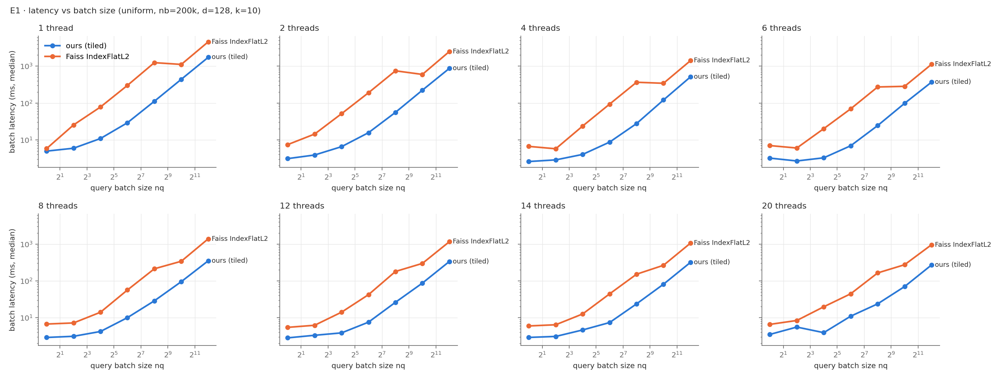

# Project 17 — Memory-efficient exact nearest-neighbour search (CS F422)

Exact Euclidean top-k over dense float32 vectors on a multicore CPU with OpenMP,
built on the exact-search ideas of Johnson, Douze & Jégou, *Billion-scale
Similarity Search with GPUs* (arXiv 2017), and compared against Faiss's CPU
exact flat L2 search (`IndexFlatL2`).

```
include/knn.h            public API + output contract (tie policy)
src/reference.cpp        D1  sequential brute-force reference + exact-neighbour checker
src/tiled.cpp            D2  OpenMP tiled distances + per-query top-k heaps
                         D3  tile / parallelism selector (select_params)
src/data.cpp             3 input families, .fbin / .fvecs I/O
tests/test_knn.cpp       hand-checked cases, checker self-test, 120 randomized differential tests
bench/knn_bench.cpp      benchmark driver (gen / run / check), CSV output
bench/bandwidth.cpp      STREAM-style memory read benchmark (E7)
bench/faiss_bench.py     Faiss IndexFlatL2 baseline with identical CSV columns
scripts/run_experiments.sh   reproduces E1–E7 and E9–E11
scripts/e8_oversplit.py      E8, run by hand (steps at the top of the script)
scripts/analyze.py       DIR/*.csv -> DIR/summary.md + figures
scripts/machine_info.sh  describes this machine (written to DIR/machine.txt)
results/i7-13650hx/      i7 laptop: E1–E11, machine.txt
results/i9-14900hx/      i9 laptop: E1–E7, E9–E11 (no E8), machine.txt
results/cloud-vm-avx512/ 2-vCPU cloud VM with AVX-512: E1, machine.txt
```

## Build & run

```bash
# deps: g++ >= 9 (OpenMP), cmake >= 3.16; for the baseline: pip install numpy faiss-cpu matplotlib
cmake -S . -B build -DCMAKE_BUILD_TYPE=Release && cmake --build build -j
./build/knn_test                         # all correctness tests
scripts/run_experiments.sh -o results/i7-13650hx          # E1..E7, E9..E11; or add e.g. E1 E5
# without -o the folder is results/<hostname>; it gets a machine.txt and a line per run
# E9 needs SIFT1M in data/sift/ (sift_base.fvecs, sift_query.fvecs from http://corpus-texmex.irisa.fr/); skipped otherwise
python3 scripts/analyze.py results/i7-13650hx             # tables + plots in that folder
# sanitizer build: cmake -S . -B build-asan -DKNN_SANITIZE=ON && cmake --build build-asan && ./build-asan/knn_test
```

Results are kept in one folder per machine, each with a `machine.txt` (CPU, cores/threads,
RAM, OS, compiler, Faiss version, and the git commit behind each experiment):

| Folder | Machine (from its `machine.txt`) | Experiments | Discussed in |
|---|---|---|---|
| `results/i7-13650hx/` | i7-13650HX laptop, 20 logical CPUs, WSL2 Ubuntu 22.04, g++ 11.4, faiss-cpu 1.16.0 | E1–E11 | all sections marked (i7-13650HX) |
| `results/i9-14900hx/` | i9-14900HX laptop, 32 logical CPUs, native Arch Linux, g++ 16.2 | E1–E7, E9–E11 | [E10](#e10-top-k-selection-heap-vs-buffer-i7-13650hx-and-i9-14900hx), [i9-14900HX](#i9-14900hx) |
| `results/cloud-vm-avx512/` | 2-vCPU cloud VM (Xeon @ 2.10 GHz, AVX-512), Ubuntu 24.04, g++ 13.3, faiss-cpu 1.16.0 | E1 | [Cloud VM](#cloud-vm-avx-512) |

`run_experiments.sh` pins both programs with `OMP_PROC_BIND=close OMP_PLACES=threads` on every
machine. The laptops use the AVX2 6 × 16 kernel (`mr=6` in the CSVs; `mr=1` for nq = 1), the
cloud VM the AVX-512 4 × 32 kernel (`mr=4`). The i7's E1–E7 and E9–E11 CSVs come from one run
(commit b8a0944 plus uncommitted changes, tile buffers kept between searches); E8 used older
code (e2dc468), from before that change.

## Input/output contract

* Input: database `Y` (nb × d), queries `X` (nq × d), float32 row-major; `k ≥ 1`.
* Output: `D[nq×k]` squared L2 distances, `I[nq×k]` int64 ids.
* **Tie policy:** rows are sorted by *(distance ascending, id ascending)*; when two
  vectors are equally far, the **smaller id wins**, both for membership in the
  top-k and for order. If nb < k the row is padded with `(+inf, -1)`.

## What each deliverable does

### D1 — reference + checker (`src/reference.cpp`)
`reference_search` computes every distance in **double precision** directly as
Σ(x−y)² (no norm expansion → no cancellation error), then `partial_sort`s with
the tie policy. It is slow on purpose (20–22 ms/query at nb=200k, d=128 on the i7-13650HX, E6) — it's
ground truth.

`check_results` decides if any result is exact. Floating-point means the fast
code can legitimately disagree with the reference on near-ties, so there are two
levels:
* **tolerant** (pass/fail): every id valid and unique; each returned id's true
  distance ≤ k-th true distance + tol; each reported distance = true distance ± tol;
  row sorted. `tol = 16·ε₃₂·√d·(‖x‖² + max‖y‖²)`.
* **strict**: ids identical to the reference (tie policy applied identically).
  For the integer-valued `ties` family all float maths is exact, so the tests
  *require* strict equality there.

The checker is itself tested: it must reject duplicate ids, out-of-range ids, a
far point swapped in, a wrong distance, and an unsorted row.

### D2 — OpenMP tiled distances + per-query top-k (`src/tiled.cpp`)
1. **Norm expansion (paper §5.1):** ‖x−y‖² = ‖x‖² + ‖y‖² − 2⟨x,y⟩. ‖y‖² is computed
   once at pack time; ‖x‖² is constant per query so selection runs on
   `‖y‖² − 2⟨x,y⟩` and ‖x‖² is added at the end (exactly the paper's trick).
2. **Packed database (preprocessing, timed separately):** rows grouped into
   panels of 16, stored dimension-major inside a panel, so one 64-byte load
   gives dimension t of 16 database rows. Padding rows get ‖y‖² = +∞ so they never win.
3. **Register-blocked micro-kernel** (the inner loop of a GEMM), chosen at compile
   time; `MR` = queries per call:
   * **AVX-512** (`__AVX512F__`): 4 queries × 32 rows → 8 accumulators, 2 loads and
     8 broadcast-FMAs per step, written with GCC/Clang vector extensions.
   * **AVX2 + FMA:** 6 queries × 16 rows in intrinsics → 12 accumulators + 2 loads
     + 1 broadcast = 15 of the 16 registers (no spills in the inner loop, checked
     with `objdump`). A 4 × 16 tile was also tried: slower at nq = 64 and 4096,
     faster at nq = 1. For nq = 1 and 2 the selector uses 1 × 16 and 2 × 16
     kernels instead of padding to 6 rows; from nq = 3 on, padding is faster.
   * Otherwise the 4 × 32 vector-extension code is the portable fallback. It is
     correct but slow on AVX2: each 16-float vector becomes two registers, so the
     8 accumulators alone fill the register file, and g++ 11 spills them to the
     stack on every step.
4. **Two-level tiling:** a database block of `tb` rows (sized to ½ L2) is kept hot
   while every `MR`-query group of a `tq`-query tile streams over it, so each
   database element fetched from memory is reused `tq` times.
5. **Fused selection from registers:** the paper fuses k-selection with the
   kernel consuming the GEMM output so the nq×nb matrix is never written. We go
   further: distances are consumed straight from the micro-kernel registers into
   per-query **bounded max-heaps** (root = current worst). A 16-lane vector
   compare against the heap threshold skips whole panels; only survivors touch
   the heap. **No distance tile is ever stored.**
   For large k the heap's O(log k) updates dominate, so there is a second method: append
   every candidate below the threshold to a buffer of 2k entries; when it is full, keep the
   k best with `nth_element` and set the threshold to the k-th (O(1) amortised). Ids are
   still scanned in increasing order, so the tie policy stays exact.
6. **Exact tie handling in the hot path:** within a task ids are scanned in
   increasing order, so a candidate equal to the threshold must lose → the
   strict `<` filter is exact. After adding ‖x‖² the row is re-sorted by the policy
   (adding ‖x‖² can create new float ties).
7. **Strict mode** (`SearchParams::strict`, off by default): results identical to
   `reference_search`, ids and distances. Selection keeps k + 8 + k/8 float candidates.
   With a rigorous bound eb on the float error of the norm expansion, only rows with
   float distance ≤ (k-th float distance + 3·eb) can be in the true top k. If all of them
   are among the candidates, those are recomputed with the reference's own double-precision
   distance function and ranked by (distance, id). If that cannot be shown (for example
   many exact ties at the k-th distance), the query is rescanned in double; the number of
   rescans is reported.
8. **Parallelism:** tasks = (query tile) × (database chunk), `schedule(dynamic)`.
   With S = 1 chunk the output arrays *are* the heaps (no extra heap memory). With
   S > 1 each chunk keeps its own heaps and a per-query merge picks the final k.

### D3 — tile / parallelism selector (`select_params`)
* `tb` = rows such that `tb·d·4 B ≈ L2/2` (read from `sysconf`).
* `tq` = 64 rounded up to a multiple of `MR` (64 on AVX-512, 66 on AVX2; shrunk when the tile + heaps exceed L2/4, and when nq is small).
* Selection: buffer for k ≥ 128, heap below (measured on the i7: the smallest k at which
  the buffer was no slower at nq = 16 and 1024, for that and every larger k tested).
* `S` (database splits): smallest S giving ≥ T tasks with ≤ 25% load imbalance,
  limited by blocks per chunk and a partial-heap memory budget (64 MiB).
  → **small batches become database-parallel** (each thread scans nb/S rows —
  the only way to use all cores for 1 query), **large batches become
  query-parallel** (no partial heaps to merge).

## Results

Every section names its machine, and every number in it comes from that machine's CSVs
(`summary.md` in each folder has the full tables). Times are the median of the repetitions in
one run: 5 (E5 grid and E6: 3; E7: see there). Unless stated: uniform data, nb = 200k,
d = 128, k = 10. On the i7 all 158 runs in E1–E4 (both libraries) pass the checker (up to
32 sampled queries per run).

### E1: batch size × threads (i7-13650HX)




Faiss time / our time at the same thread count (above 1 = we are faster):

| nq | T=1 | 2 | 4 | 6 | 8 | 12 | 14 | 20 |
|---|---|---|---|---|---|---|---|---|
| 1 | 1.02 | 2.50 | 2.42 | 2.27 | 2.22 | 2.15 | 2.13 | 1.97 |
| 4 | 4.60 | 2.81 | 2.35 | 2.05 | 2.20 | 1.91 | 2.06 | 2.23 |
| 16 | 6.57 | 7.26 | 5.75 | 6.22 | 3.53 | 3.19 | 3.25 | 2.02 |
| 64 | 10.97 | 12.25 | 11.10 | 11.73 | 5.28 | 5.58 | 5.28 | 6.93 |
| 256 | 10.49 | 12.89 | 12.23 | 11.67 | 8.26 | 6.53 | 6.38 | 7.14 |
| 1024 | 2.56 | 2.66 | 2.73 | 2.89 | 3.81 | 3.41 | 3.21 | 6.63 |
| 4096 | 2.72 | 2.79 | 2.85 | 3.06 | 4.08 | 3.49 | 3.37 | 4.49 |

* **nq = 4 to 256**, where Faiss 1.16 uses its per-pair sequential path: 1.9–12.9× faster.
* **nq ≥ 1024** (Faiss BLAS path): 2.6–6.6× faster.
* **nq = 1:** at 1 thread 5.35 ± 0.17 vs 5.45 ± 0.34 ms
  (median ± standard deviation), a tie. From 2 threads on we are 1.97–2.50× faster: our scan is
  split over the threads, Faiss's single query is not.
* **Self-speedup** (over each library's own 1-thread time), ours / Faiss:

| nq | T=2 | 4 | 6 | 8 | 12 | 14 | 20 |
|---|---|---|---|---|---|---|---|
| 1 | 1.44 / 0.59 | 2.01 / 0.85 | 2.10 / 0.95 | 1.86 / 0.86 | 1.86 / 0.89 | 1.85 / 0.89 | 1.61 / 0.84 |
| 64 | 1.82 / 1.63 | 3.36 / 3.32 | 4.54 / 4.25 | 2.76 / 5.74 | 3.66 / 7.20 | 4.12 / 8.56 | 4.58 / 7.26 |
| 4096 | 2.05 / 2.01 | 3.61 / 3.46 | 4.64 / 4.14 | 5.05 / 3.37 | 5.37 / 4.20 | 5.67 / 4.59 | 6.11 / 3.71 |

  At nq = 64 Faiss's self-speedup is higher than ours from 8 threads on, from a
  1-thread time that is 11.0× longer (304 vs 27.67 ms). The 20-thread column is
  the noisiest (median standard deviation 17% of the median, against
  2–6% for the other thread counts). WSL hides P- and E-cores, so T = 12 is not
  "P-cores only".

### E2–E4: dimension, k, input family (i7-13650HX, 14 threads)

Ours / Faiss in ms (Faiss time / our time). 14 threads rather than all 20, because the
20-thread runs are the noisiest in E1. Rows whose standard deviation is above 15% of the
median: d = 32, nq = 1 (ours 125%, Faiss 52%), d = 128, nq = 1 (Faiss 42%), d = 512, nq = 64 (Faiss 21%), k = 1, nq = 16 (Faiss 16%); read those as "faster", not as a precise ratio.

E2, nb = 100k, k = 10:

| d | nq = 1 | nq = 64 | nq = 1024 |
|---|---|---|---|
| d = 32 | 0.09 / 0.28 (3.3×) | 1.09 / 3.62 (3.3×) | 12.86 / 60.35 (4.7×) |
| d = 128 | 1.17 / 2.33 (2.0×) | 3.92 / 18.63 (4.7×) | 45.49 / 162 (3.6×) |
| d = 512 | 5.98 / 15.77 (2.6×) | 14.32 / 110 (7.7×) | 200 / 443 (2.2×) |

E3:

| k | nq = 16 | nq = 1024 |
|---|---|---|
| k = 1 | 4.01 / 13.45 (3.4×) | 84.98 / 233 (2.7×) |
| k = 10 | 4.41 / 12.83 (2.9×) | 84.05 / 287 (3.4×) |
| k = 100 | 4.63 / 13.50 (2.9×) | 98.63 / 284 (2.9×) |
| k = 1000 | 8.53 / 17.23 (2.0×) | 165 / 316 (1.9×) |

E4, k = 10:

| family | nq = 1 | nq = 64 | nq = 1024 |
|---|---|---|---|
| clustered | 2.85 / 6.01 (2.1×) | 6.83 / 37.81 (5.5×) | 85.59 / 277 (3.2×) |
| ties | 2.92 / 5.73 (2.0×) | 7.33 / 36.33 (5.0×) | 84.17 / 269 (3.2×) |

* **Unfavourable case, large k:** the lead falls from 3.4× (k = 10) to 1.9× (k = 1000) at
  nq = 1024, and from 2.9× to 2.0× at nq = 16, as selection costs more.

### E5: selector against a grid (i7-13650HX, 20 threads)


Grid: S ∈ {1, 2, 4, 8, 16, 20} × tq ∈ {6, 18, 66} × tb ∈ {256, 2048, 16384} = 54 configs per nq.

| nq | selector ms | selector S | best grid ms | best grid S, tq, tb | selector / best | worst / best |
|---|---|---|---|---|---|---|
| 1 | 5.35 | 20 | 2.46 | 8, 66, 256 | 2.18 | 2.57 |
| 4 | 2.99 | 20 | 2.47 | 8, 6, 16384 | 1.21 | 4.52 |
| 16 | 3.77 | 20 | 3.21 | 20, 18, 256 | 1.18 | 4.97 |
| 64 | 6.33 | 20 | 5.28 | 20, 66, 256 | 1.20 | 8.37 |
| 256 | 20.39 | 5 | 18.16 | 8, 66, 256 | 1.12 | 7.91 |
| 1024 | 74.41 | 2 | 70.93 | 2, 66, 256 | 1.05 | 5.95 |

* The selector is within 1.05–2.18× of the best grid config; the worst config is
  2.6–8.4× slower than the best.
* The selector's nq = 1 row is a noisy single run: standard deviation 19% of its median,
  fastest repetition 3.15 ms (1.28× the best grid median).

### E6: sequential double-precision reference (i7-13650HX)

21.6 ms for 1 query, 20.3 ms per query for 16.

### E7: is nq = 1 limited by memory bandwidth? (i7-13650HX)


Yes. At every thread count our nq = 1 scan (packed database bytes / time) runs at
89–105% of a plain memory read of a same-sized array (medians of 5 rounds; scan range
in brackets):

| T | read 99 MiB (GB/s) | our scan (GB/s, range) | ratio |
|---|---|---|---|
| 1 | 23.4 | 23.7 (21.3–24.1) | 101% |
| 2 | 31.5 | 32.7 (29.4–34.8) | 104% |
| 4 | 40.5 | 41.2 (37.1–41.4) | 102% |
| 6 | 41.6 | 41.5 (39.1–43.0) | 100% |
| 8 | 37.9 | 36.1 (34.7–41.3) | 95% |
| 12 | 40.7 | 36.0 (35.9–39.3) | 89% |
| 14 | 35.7 | 37.5 (35.3–38.9) | 105% |
| 20 | 34.3 | 34.8 (16.6–35.1) | 101% |

One thread scans a database that fits in L2 (2000 rows) at 73.0 GB/s
(68.0–75.5 over 5 rounds; one search takes 13.7–15.2 µs), 3.1× its
23.7 GB/s from RAM, so the kernel is not the limit. One thread already reads at
23.4 of the at most 41.6 GB/s, which allows at most about 1.8× from more threads;
the scan here goes from 4.35 ms at 1 thread to at best 2.49 ms (6 threads), 1.75×. E1's
larger 2.10× (6 threads) is a single run whose 1-thread time (5.35 ms) was slower than E7's.

The in-cache rows were rerun after a fix: `knn_bench` used to print times rounded to whole
microseconds, a ±7% step for a 13 µs search. Times are now printed to the nanosecond. Only
the i7's in-cache rows were rerun; the other E7 rows are unchanged. The i9's in-cache rows
still have the old rounding and are not reported.

### E8: over-decomposition, tried and not kept (i7-13650HX, older code)

Giving each thread about 4 database chunks made nq = 64 at 8 threads 19–24% faster, but was
up to 46% slower at k = 1000, and a restricted version was up to 23% slower at 6 threads,
so the selector was left unchanged. These numbers are from code e2dc468 and are not in a
CSV; details: [results/i7-13650hx/e8_oversplit.md](results/i7-13650hx/e8_oversplit.md).

### E9–E11 (i7-13650HX, 14 threads)

#### E9: SIFT1M (real data)

nb = 1M, d = 128 (integer-valued SIFT descriptors), k = 10. All runs of both libraries pass
the checker.

| nq | ours ms | Faiss ms | Faiss / ours | Faiss path |
|---|---|---|---|---|
| 1 | 15.11 | 32.70 | 2.2× | seq |
| 64 | 34.03 | 257 | 7.5× | seq |
| 1024 | 433 | 1379 | 3.2× | blas |

#### E10: top-k selection, heap vs buffer (i7-13650HX and i9-14900HX)

Uniform, nb = 200k, d = 128, 14 threads, one run on each machine. All runs pass the checker.
Times are not comparable across machines; the ratios are.

| k | nq | i7 heap ms | i7 buffer ms | i7 buffer / heap | i9 heap ms | i9 buffer ms | i9 buffer / heap | selector picks |
|---|---|---|---|---|---|---|---|---|
| 1 | 16 | 4.06 | 3.92 | 0.97 | 2.75 | 2.73 | 0.99 | heap |
| 1 | 1024 | 85.34 | 83.77 | 0.98 | 97.02 | 97.75 | 1.01 | heap |
| 10 | 16 | 4.11 | 3.94 | 0.96 | 2.66 | 2.53 | 0.95 | heap |
| 10 | 1024 | 87.32 | 86.11 | 0.99 | 99.79 | 101 | 1.01 | heap |
| 100 | 16 | 4.28 | 4.25 | 0.99 | 3.05 | 2.62 | 0.86 | heap |
| 100 | 1024 | 97.05 | 95.62 | 0.99 | 117 | 111 | 0.95 | heap |
| 1000 | 16 | 8.63 | 9.71 | 1.12 | 8.57 | 5.59 | 0.65 | buffer |
| 1000 | 1024 | 168 | 163 | 0.97 | 174 | 141 | 0.81 | buffer |

* At k = 1 and 10 the buffer is within 0.95–1.01× of the heap on both machines, so
  keeping it costs nothing at small k (the selector uses the heap there anyway).
* **The crossover differs per machine.** On the i9 the buffer is already 14% (nq = 16)
  and 5% (nq = 1024) faster at k = 100, and 35% and 19% faster at k = 1000. On the i7 it
  is no faster at k = 100 (0.99× and 0.99×), and at k = 1000 it is 3% faster at nq = 1024
  but 12% slower at nq = 16 in this run.
* The selector's threshold (buffer for k ≥ 128) came from a sweep on the i7. On the i9 it
  leaves k = 100 on the slower heap; the crossover there lies at or below k = 100 and was not
  pinned down. A per-machine threshold (for example measured at startup, or tied to the
  cache sizes) was not tried.

#### E11: strict mode on vs off

nb = 200k, d = 128, k = 10. All runs pass the checker.

| family | nq | off ms | on ms | on / off | rescans | ids equal to reference, off → on |
|---|---|---|---|---|---|---|
| uniform | 1 | 2.89 | 2.82 | 0.98 | 0 | 1/1 → 1/1 |
| uniform | 64 | 7.01 | 7.27 | 1.04 | 0 | 32/32 → 32/32 |
| uniform | 1024 | 80.38 | 86.70 | 1.08 | 0 | 32/32 → 32/32 |
| clustered | 1 | 2.85 | 2.81 | 0.99 | 0 | 1/1 → 1/1 |
| clustered | 64 | 6.97 | 7.67 | 1.10 | 0 | 31/32 → 32/32 |
| clustered | 1024 | 83.30 | 86.57 | 1.04 | 0 | 31/32 → 32/32 |
| ties | 1 | 3.03 | 2.89 | 0.95 | 0 | 1/1 → 1/1 |
| ties | 64 | 6.91 | 7.45 | 1.08 | 0 | 32/32 → 32/32 |
| ties | 1024 | 79.32 | 82.49 | 1.04 | 0 | 32/32 → 32/32 |

* No query needed a rescan on these datasets; the overhead is 0.95–1.10× in single runs
  at 14 threads, which is within run-to-run noise for most rows.
* Strict mode made more rows identical to the reference: clustered at nq = 64, 31/32 → 32/32; clustered at nq = 1024, 31/32 → 32/32.
* Rescans do happen on adversarial data: in the tests, values offset by 1000 make the float
  norm expansion lose most digits; non-strict then matched the reference in 1 of 389 rows,
  strict in all of them, by rescanning every query (test output, not a CSV).

### Memory (i7-13650HX)

Extra memory of the search over the 79 E1–E4 cases:

| | Ours, calculated | Ours, measured | Faiss, measured |
|---|---|---|---|
| Faiss BLAS path (24 cases) | 33 KiB – 4.0 MiB | 0.0 – 3.8 MiB | 5.3 – 41.5 MiB |
| Faiss sequential path (55 cases) | 3 KiB – 4.1 MiB | 0.0 – 5.8 MiB | 0.0 – 6.7 MiB |

* *Calculated* (`tiled_working_bytes`) is the tile copies plus partial heaps. *Measured* is the
  growth of peak RSS during the searches, the same way for both. It includes thread stacks and
  allocator overhead, but reads low (even 0, or below the calculated size) when
  earlier setup already set a higher peak.
* **BLAS path:** we measured less than Faiss in 24 of 24 cases. E1 at nq = 4096:
  0.0–1.3 MiB against 19.5–20.2 MiB.
* **Sequential path:** mixed. We measured less in 36 cases, the same in 6 and more in 13,
  so "memory efficient" is not a claim for that path.
* **Tile buffers are kept.** Each thread keeps its query-tile buffer between searches and only
  grows it, instead of allocating and freeing it in every search. Peak growth at d = 512,
  nb = 100k, nq = 4096, 20 threads (peak counter reset before the first search, 3 runs; calculated
  size 3.5 MiB; measured by hand when the change was made, not in a CSV):

| Searches | Before | After |
|---|---|---|
| 1 | 3.9–4.1 MiB | 3.9 MiB |
| 11 | 26.2–26.4 MiB | 4.5–4.6 MiB |
| 101 | 26.2–26.4 MiB | 4.5–4.6 MiB |

### i9-14900HX

A teammate's run of E1–E7 and E9–E11 on an i9-14900HX laptop (32 logical CPUs, native Linux,
so not under WSL), with commit 1b77911 plus uncommitted changes that were not recorded. Its
`machine.txt` says faiss-cpu was not installed when the file was written, but its E1–E4 and
E9 CSVs contain Faiss rows, so the Faiss version used is not known. All 186 runs in E1–E4
pass the checker. Do not mix its times with the i7's; full tables in
[results/i9-14900hx/summary.md](results/i9-14900hx/summary.md).

E1, Faiss time / our time:

| nq | T=1 | 2 | 4 | 6 | 8 | 12 | 14 | 20 | 24 | 32 |
|---|---|---|---|---|---|---|---|---|---|---|
| 1 | 1.06 | 3.12 | 2.86 | 2.97 | 2.21 | 2.50 | 2.51 | 1.81 | 1.39 | 2.53 |
| 4 | 3.00 | 2.57 | 2.47 | 2.81 | 2.75 | 2.56 | 2.01 | 1.37 | 1.36 | 1.65 |
| 16 | 5.82 | 3.82 | 4.30 | 4.24 | 2.92 | 3.83 | 4.38 | 1.13 | 1.12 | 1.81 |
| 64 | 7.77 | 4.70 | 5.36 | 4.97 | 4.43 | 5.57 | 5.78 | 3.76 | 3.22 | 6.68 |
| 256 | 8.09 | 5.02 | 5.89 | 5.60 | 5.31 | 6.76 | 6.09 | 6.04 | 5.94 | 4.37 |
| 1024 | 2.60 | 2.85 | 2.98 | 2.98 | 3.19 | 3.10 | 3.08 | 3.26 | 2.88 | 4.19 |
| 4096 | 2.58 | 2.92 | 3.00 | 3.05 | 3.11 | 3.14 | 3.12 | 3.46 | 3.77 | 4.14 |

* nq = 4 to 256 (Faiss sequential path): 1.1–8.1×; nq ≥ 1024 (BLAS path): 2.6–4.2×;
  nq = 1: 1.06× at 1 thread, 1.39–3.12× from 2 threads on.
* Self-speedup, ours / Faiss:

| nq | T=2 | 4 | 6 | 8 | 12 | 14 | 20 | 24 | 32 |
|---|---|---|---|---|---|---|---|---|---|
| 1 | 1.18 / 0.40 | 1.95 / 0.73 | 2.18 / 0.78 | 1.98 / 0.95 | 2.83 / 1.21 | 3.01 / 1.27 | 2.30 / 1.35 | 2.06 / 1.57 | 1.76 / 0.74 |
| 64 | 0.98 / 1.63 | 1.76 / 2.55 | 2.53 / 3.95 | 2.93 / 5.14 | 3.96 / 5.53 | 4.59 / 6.17 | 3.69 / 7.63 | 3.85 / 9.29 | 6.26 / 7.29 |
| 4096 | 1.09 / 0.96 | 1.98 / 1.71 | 2.85 / 2.42 | 3.49 / 2.90 | 4.79 / 3.94 | 5.23 / 4.33 | 7.03 / 5.24 | 7.99 / 5.47 | 7.57 / 4.72 |

* E2–E4 (14 threads): 1.3–12.9× faster than Faiss over all 23 cases.
* E5 (32 threads): the selector is within 1.06–1.63× of the best of 72 grid configs.
* E6: 11.9 ms for 1 query, 10.8 ms per query for 16.
* E7: the nq = 1 scan runs at 80–100% of a 99 MiB memory read:

| T | read 99 MiB (GB/s) | our scan (GB/s, range) | ratio |
|---|---|---|---|
| 1 | 28.4 | 27.9 (27.8–28.2) | 98% |
| 2 | 35.7 | 35.7 (35.2–35.8) | 100% |
| 4 | 61.3 | 60.5 (58.7–61.3) | 99% |
| 6 | 72.5 | 71.2 (67.2–71.5) | 98% |
| 8 | 77.7 | 77.4 (76.8–78.7) | 100% |
| 12 | 96.8 | 94.2 (93.6–94.9) | 97% |
| 14 | 101.7 | 100.6 (96.4–102.1) | 99% |
| 20 | 105.7 | 88.8 (79.1–96.0) | 84% |
| 24 | 99.6 | 79.8 (76.4–91.6) | 80% |
| 32 | 86.5 | 74.1 (55.8–81.8) | 86% |

* E9, SIFT1M:

| nq | ours ms | Faiss ms | Faiss / ours | Faiss path |
|---|---|---|---|---|
| 1 | 6.69 | 15.82 | 2.4× | seq |
| 64 | 30.54 | 173 | 5.6× | seq |
| 1024 | 460 | 1459 | 3.2× | blas |

* E11: no rescans; strict mode costs 0.90–1.07× in single runs.

### Cloud VM (AVX-512)

A shared 2-vCPU cloud VM (Xeon @ 2.10 GHz) with the AVX-512 4 × 32 kernel, commit 366799c
plus uncommitted changes, pinned like the laptops; E1 only, at 1 and 2 threads. All 28 runs pass
the checker. Do not compare its times with the laptops'.

Faiss time / our time:

| nq | T=1 | 2 |
|---|---|---|
| 1 | 1.32 | 2.92 |
| 4 | 3.22 | 3.64 |
| 16 | 6.62 | 4.17 |
| 64 | 9.18 | 6.65 |
| 256 | 8.04 | 5.62 |
| 1024 | 2.99 | 3.30 |
| 4096 | 3.35 | 3.72 |

* nq = 4 to 256 (Faiss sequential path): 3.2–9.2×; nq ≥ 1024 (BLAS path): 3.0–3.7×.
* Self-speedup at 2 threads, ours / Faiss:

| nq | T=2 |
|---|---|
| 1 | 1.78 / 0.80 |
| 4 | 2.69 / 2.38 |
| 16 | 2.53 / 4.01 |
| 64 | 2.16 / 2.98 |
| 256 | 1.69 / 2.42 |
| 1024 | 1.96 / 1.77 |
| 4096 | 1.78 / 1.60 |

* Calculated working memory at most 79.5 KiB in E1. Full tables:
  [results/cloud-vm-avx512/summary.md](results/cloud-vm-avx512/summary.md).

**Fairness notes.** Same machine, same data files, same thread count via
`omp_set_num_threads`, same pinning, only `search` timed (Faiss `add` and
our packing are reported as preprocessing), outputs preallocated for both.
Faiss is the faiss-cpu 1.16.0 pip wheel (OpenBLAS) on the i7 and the VM, and of unknown
version on the i9; an MKL build of Faiss would
likely be faster on the BLAS path, so we **don't claim general superiority** —
our claim is for the constrained regime the brief suggests: **small/medium
batches** (and, on Faiss's BLAS path, less extra memory in the cases we measured). Faiss's current `main` adds a
database-parallel path for nq < threads that 1.16 doesn't use here; that would
narrow the nq=1 gap.

## Limitations and future work

* **Faiss build:** only the pip wheel (OpenBLAS) was compared. An MKL build would
  likely be faster on the BLAS path (nq ≥ 1024), and Faiss's current `main`, with its
  database-parallel path for small batches, was not tested.
* **Per-machine tuning:** the selector's constants (buffer from k ≥ 128, the 1- and 2-row
  kernels, tile sizes) were measured on the i7 only. E10 shows that the heap/buffer
  crossover differs per machine (the i9 already gains at k = 100) and it was not pinned
  down on either. In E5 the selector splits the database more than the best grid
  configuration at nq = 1 and 4 (more than 5% slower there).
* **Unequal threads:** chunks are equal in size while threads run at unequal speed. The fix
  tried in E8 was rejected, and WSL hides which cores are P- or E-cores, so this was not
  separated.
* **Strict mode fallback:** when the extra candidates cannot prove the result, the query is
  rescanned in double over the whole database; a float rescan limited to the error band
  would be cheaper.
* **Memory on Faiss's sequential path:** mixed; no memory advantage is claimed there.
* **Profiling:** no hardware-counter profile (`perf stat`: FLOP rate, cache misses) was made.
